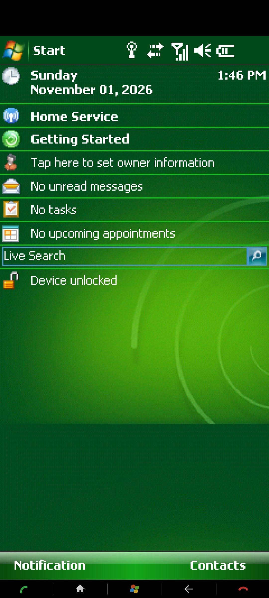
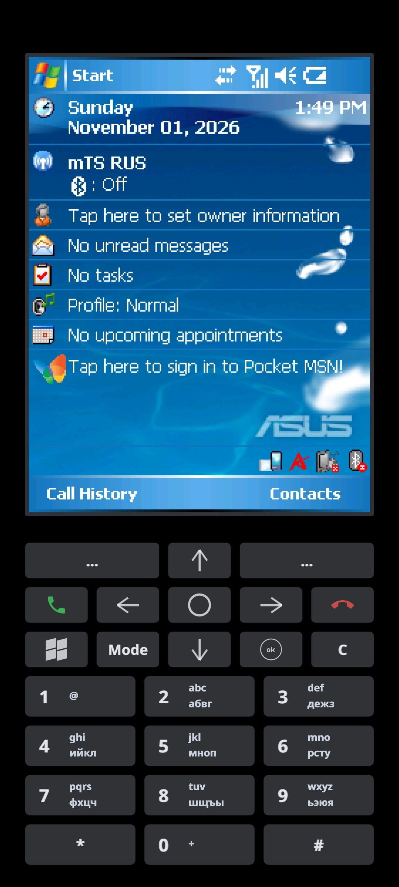
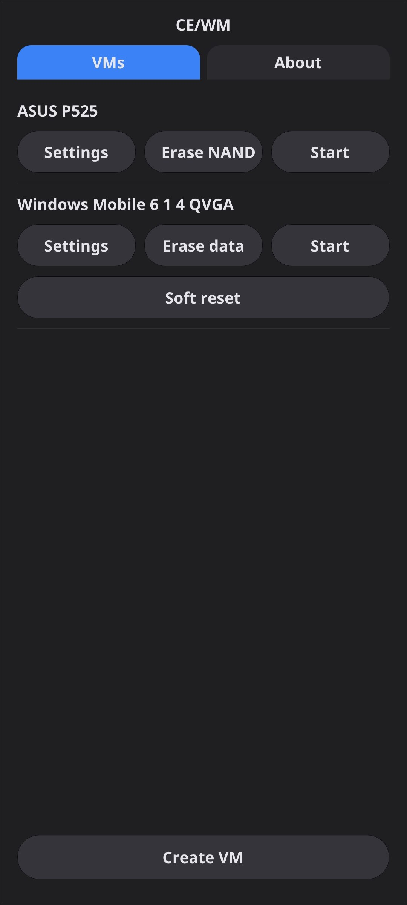

# CE/WM

**Windows Mobile and Windows CE, back on your phone.**

CE/WM emulates classic handhelds on Android and Aurora OS, with a touch-friendly launcher, saved virtual machines, networking, and an on-screen keypad. Based on [CERF](https://github.com/gweslab/cerf).

[**Download 1.4.0**](https://github.com/erhoof/cewm/releases/tag/cewm-release-1.4.0) · [Report a bug](https://github.com/erhoof/cewm/issues)

<p align="center">
  
  
  
</p>

## What you can do

- Run Microsoft Device Emulator images and supported ASUS P525, Compaq iPAQ, HP Jornada 720, and Siemens SIMpad systems.
- Install **Windows Mobile 6.1.4 QVGA** from the empty launcher with one tap, choose another image from the online catalog, or import your own ROM.
- Save and resume each VM independently. Use **Soft reset** on Device Emulator to reboot without erasing its RAM-backed user data.
- Keep a ROM's original width while extending the guest display to fill your phone. This is the default for new Device Emulator VMs.
- Use Guest Additions for a shared folder, NAT networking, and display resizing. An optional HTTP proxy lets the host retrieve HTTPS pages for older guest browsers.
- Use on-screen navigation buttons or the ASUS P525 T9 keypad.
- Choose **English**, **Russian**, or **System default** in About. Russian system locales select Russian; other locales select English.

Unicorn JIT is enabled by default for new Device Emulator VMs. Other device families use the interpreter; JIT is disabled for them. Existing VMs retain their saved CPU choice.

## Install on Android

The APK targets **64-bit ARM devices running Android 8.0 or later**. Download `ru.erhoof.cewm-aarch64.apk` from [Releases](https://github.com/erhoof/cewm/releases), install it, and open CE/WM.

On the first screen, tap **Install WM 6.1.4 QVGA**. The app downloads, verifies, unpacks, and creates the VM. Alternatively, use **Create VM** to import an image or browse the catalog. No ROM is bundled in the APK or this repository; image rights remain with their owners.

Android's **All files access** setting lets the ROM browser read Downloads and lets you share that folder with a guest. App-specific VM storage does not require that access. There is no phone-state permission request at startup. Real cellular calling is experimental, requires a separate opt-in through **About → Phone / WM calls**, and asks for call access and the default phone role. SMS is not implemented.

## Saved machines and recovery

Each VM has its own directory containing its ROM, settings, saved machine, and `Storage` shared folder. On Android these live below the app's external files directory in `Documents/CEWM`; on Aurora they live in `~/Documents/CEWM`.

To recover a stuck Device Emulator guest, return to the launcher and use **Soft reset**. **Erase data** discards the saved machine and starts fresh. **Erase NAND** on ASUS P525 restores its writable storage to a blank image. Back up the VM directory before using either erase action. Uninstalling the Android app or clearing its data also removes its app-specific VMs.

Soft reset preserves RAM; it cannot repair a corrupted guest filesystem. Device Emulator currently persists its user data through whole-machine snapshots rather than a separate NAND image.

## Build with Gradle

Use Linux, **JDK 17**, **Gradle 8.1.1**, Android SDK platform **34**, NDK **r27c**, CMake, Ninja, and Git. Gradle packages the Android app after the native libraries and runtime assets are prepared. Build configuration is in `app/android`; no helper build scripts or local SDK settings are committed.

Clone the project and the SDL2 dependency:

```sh
git clone --recurse-submodules https://github.com/erhoof/cewm.git
cd cewm
mkdir -p ../android-ports
git clone https://github.com/savegame/SDL.git ../android-ports/SDL
git -C ../android-ports/SDL checkout c27776d4ee8055e9a1e543b21eb43e71983ebea6

export JAVA_HOME=/path/to/jdk-17
export ANDROID_HOME=/path/to/android-sdk
export ANDROID_NDK=/path/to/android-ndk-r27c
```

Build the patched Unicorn 2.1.4 dependency. Use a fresh checkout so the patches are applied once:

```sh
git clone --branch 2.1.4 --depth 1 https://github.com/unicorn-engine/unicorn.git /tmp/cewm-unicorn
# Run from the CE/WM repository root:
git -C /tmp/cewm-unicorn apply "$PWD/app/engine/unicorn-fast.patch" "$PWD/app/engine/unicorn-cewm.patch"
cmake -S /tmp/cewm-unicorn -B /tmp/cewm-unicorn-build -G Ninja   \
  -DCMAKE_TOOLCHAIN_FILE="$ANDROID_NDK/build/cmake/android.toolchain.cmake" \
  -DANDROID_ABI=arm64-v8a -DANDROID_PLATFORM=android-26 \
  -DANDROID_SUPPORT_FLEXIBLE_PAGE_SIZES=ON -DUNICORN_ARCH=arm \
  -DUNICORN_BUILD_TESTS=OFF -DBUILD_SHARED_LIBS=OFF \
  -DCMAKE_POSITION_INDEPENDENT_CODE=ON -DCMAKE_BUILD_TYPE=Release \
  -DCMAKE_INSTALL_LIBDIR=lib -DCMAKE_INSTALL_PREFIX="$PWD/app/build/unicorn-prefix"
cmake --build /tmp/cewm-unicorn-build -j1
cmake --install /tmp/cewm-unicorn-build
```

Build the native libraries and prepare the app's assets:

```sh
cmake -S app -B app/build/android -G Ninja   \
  -DCMAKE_TOOLCHAIN_FILE="$ANDROID_NDK/build/cmake/android.toolchain.cmake" \
  -DANDROID_ABI=arm64-v8a -DANDROID_PLATFORM=android-26 \
  -DANDROID_SUPPORT_FLEXIBLE_PAGE_SIZES=ON -DCMAKE_BUILD_TYPE=Release \
  -DCEWM_UNICORN_DIR="$PWD/app/build/unicorn-prefix"
cmake --build app/build/android -j1 --target cewm SDL2
mkdir -p app/android/app/libs/arm64-v8a app/android/app/src/main/assets
cp app/build/android/libmain.so app/android/app/libs/arm64-v8a/
cp app/build/android/SDL2/libSDL2.so app/android/app/libs/arm64-v8a/
cp -r app/runtime app/android/app/src/main/assets/
(cd app/runtime && find . -type f | sed 's|^\./||') > app/android/app/src/main/assets/runtime.lst
```

Then build the APK with Gradle:

```sh
gradle -p app/android --no-daemon --max-workers=1 assembleDebug
```

The result is `app/android/app/build/outputs/apk/debug/app-debug.apk`. This uses Android's debug signing. Keep private release keys outside the repository. The complete source archive attached to the release also includes SDL2 and patched Unicorn; use its Unicorn source directly without reapplying patches.

Ported CERF, libCerfEngine, and dynarmic snapshots are pinned as Git submodules and hosted on the `vendor/cerf`, `vendor/libcerfengine`, and `vendor/dynarmic` branches of this repository. Dear ImGui, libslirp, and curl headers are included in `app/third_party`.

## Status

Android installation and launcher behavior have been exercised on a Pixel 8. Local tests cover CPU/MMU behavior, modem parsing, locale and settings policies, snapshots, and Device Emulator warm reboot. Compatibility depends on the ROM and board. Real cellular call handling, device-specific input, and idle battery consumption still need wider testing.

For a useful bug report, include your device, Android/Aurora version, board and ROM version, whether Guest Additions and JIT are enabled, and steps to reproduce. Do not upload ROMs or private guest data.

## Credits and licensing

Created by **Pavel Bibichenko** ([@erhoof](https://github.com/erhoof)). Thanks to **@sashikknox** for the Dear ImGui launcher template.

Built with CERF / libCerfEngine, Unicorn, dynarmic, libslirp, Dear ImGui, and SDL2. See [LICENSE](LICENSE) and [THIRD_PARTY_NOTICES](THIRD_PARTY_NOTICES). The Unicorn-enabled Android release is distributed under GPLv2; third-party components retain their own notices. Windows Mobile, Windows CE, and device firmware are not covered by the project's license.
